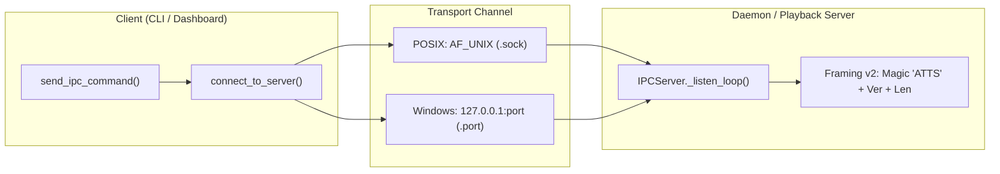

# Windows Playback IPC Architecture & Testing

Playback control parity across POSIX and Windows using portable TCP loopback and atomic channel ownership.

## Overview

On POSIX systems, `agent-tts` uses Unix domain sockets (`AF_UNIX`) for low-latency IPC. Because Windows lacked consistent `AF_UNIX` support historically, the Windows runtime uses TCP loopback (`127.0.0.1`) on an ephemeral port, persisting the port number to a marker file (`IPC_PORT_FILE`).

This document describes the intended channel lifecycle, process liveness checks, and portability fixtures. Local loopback tests exercise the Windows transport branch, but they do not replace a native Windows run or prove native `msvcrt` locking.

## Core Invariants

| Invariant | Mechanism | Platform Detail |
|---|---|---|
| **Atomic Election** | Exclusive file locking | POSIX: `fcntl.flock(LOCK_FILE)`. Windows: `msvcrt.locking` on sentinel byte of `IPC_PORT_FILE`. |
| **No Marker Theft** | Live server probe | `server_socket()` verifies `_channel_is_live()`. Second players (even within the same process) never overwrite an active marker. |
| **Orphan Reclaim** | Stale marker reuse | Unresponsive endpoints are reclaimed by the elected owner (or explicit `require_ownership=False` test harnesses). |
| **Clean Endpoint Teardown** | Binding and ownership guard | A failed-start or already-stopped server does not unlink a winner's marker. Replacement-marker identity remains a pre-existing limitation (see below). |
| **Safe Process Liveness** | Non-terminating query | POSIX: `os.kill(pid, 0)`. Windows: Win32 `OpenProcess` + `WaitForSingleObject` (never `os.kill` or `TerminateProcess`). |

## Architecture & Wire Protocol



## Channel Marker Isolation

To avoid cross-test collisions:
1. `constants.IPC_PORT_FILE` defaults to `%TEMP%/agent-tts-ipc.port`.
2. `AGENT_TTS_PORT_FILE` environment variable allows overriding the path.
3. Test fixtures (`channel` and autouse `isolate_ipc_port_file` in `conftest.py`) isolate the port file in `tmp_path`, automatically passed down to child processes via environment variables.

## Running Tests

From the `engine/` directory:

```bash
# Run all Windows and cross-platform IPC tests
python -m pytest tests/test_windows_ipc.py tests/test_ipc.py tests/test_ipc_ownership.py tests/test_ipc_transport.py tests/test_ipc_framing_v2.py tests/test_ipc_concurrency.py tests/test_daemon.py tests/test_daemon_lifecycle.py -v
```

`tests/test_windows_ci_invariants.py` retains independent regression probes for marker hashes, subprocess election, environment inheritance, and non-terminating Win32 HANDLE queries.

## Evidence and limits

- Native Windows CI (`41485223219`): **1403 passed, 82 skipped, 0 failed**. The 82 skips are all audited POSIX/WSL2, AF_UNIX-parameterised, real-PowerShell, optional-numpy, `/proc`, `chmod` or self-SIGINT cases; no TCP channel case is skipped. Linux: 1474 passed / 11 skipped.
- Iterating on real Windows found three defects the local Linux suite could not: Windows cannot unlink a file held under a mandatory lock (the marker is truncated instead), `_pid_looks_like_agent_tts` trusted every PID without `/proc`, and the POSIX identity fallback broke macOS until `ps(1)` was added.
- The independent verifier found no change-caused regression, but its overall verdict is **partial**, not an unconditional platform pass.
- A pre-existing limitation remains: if another actor rewrites a running server's marker to name a different live endpoint, the original server's `stop()` can remove that replacement marker. The same probe fails at baseline `cb10023`; `_bound` protects failed-start and duplicate-stop cases, not arbitrary marker replacement.
- The idle-clock timing test failed on both baseline and candidate in scratch and then passed in isolation. This is recorded as baseline debt, not silently rerun into a clean result.
