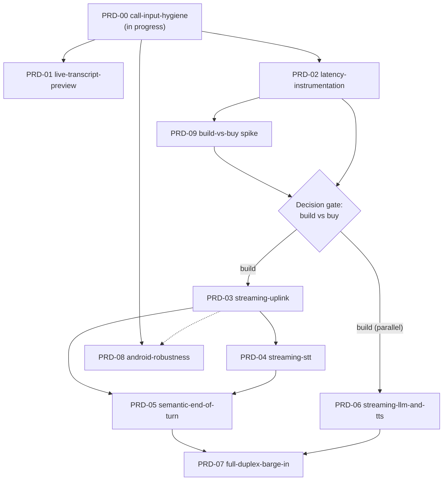

# Live Call Roadmap: from batched turns to a Gemini-Live-class call

| Field | Value |
|---|---|
| **Product** | `herdr-brain` (PWA / Service) |
| **Document Type** | Roadmap + PRD index |
| **Status** | `draft` |
| **Date** | 2026-11-03 |
| **Composed Skills** | `prd`, `cognitive-doc-design` |
| **Canonical Entrypoint** | `hosts/herdr/brain/docs/live-call/ROADMAP.md` |
| **Target Repository Root** | `/home/bruno/Code/personal/agent-tts` |

---

## 1. Goal

Close the experience gap between today's hands-free voice call and a Gemini-Live-class call: an always-open microphone with no system beeps, end-of-turn decided semantically instead of by a fixed silence timer, and audio streaming in both directions so the answer starts speaking in about a second — while keeping execution local-first and the approval gate strictly enforced.

The pain that motivates this roadmap, in the user's words (Pixel 7 Pro, PWA, Navegador engine):

> "comienza a sonar el permiso de micro sin parar" — the Android Web Speech earcon loops while idle.
>
> "me corta mientras hablo, haciendo que tenga que hacer mas de un turno" — sessions end on short pauses, splitting turns mid-sentence.

The destination, per the Gemini Live comparison below: the phone streams audio both ways and the server decides turn end from what was said, not from an energy threshold.

---

## 2. Current state (verified)

```
  Phone (PWA)                                Server (FastAPI)
  ┌──────────────────────────┐               ┌─────────────────────────────────┐
  │ getUserMedia (AEC+NS)    │  webm/opus    │                                 │
  │ kept open whole call     │  segments     │ /transcribe (faster-whisper,    │
  │ vad.js energy VAD ───────┼── 45s rotate ─►│   local builtin or stt_engine) │
  │ silence 1.2s → 2.5s      │  POST blob    │        │                        │
  │ + 1.5s continuation      │               │        ▼                        │
  │ transcripts accumulate ──┼──────────────►│ /ask (GLM tool loop, approval   │
  │ ONE /ask per turn        │               │   gate) → sentence-split TTS    │
  │ segmentPlayer ◄──────────┼───────────────┤ /speech/{id}/next (protocol-2   │
  │ (long-poll playback)     │  audio segs   │   segmented delivery)           │
  └──────────────────────────┘               └─────────────────────────────────┘
```

| Component | Evidence |
|---|---|
| Servidor engine: getUserMedia (`echoCancellation`, `noiseSuppression`) open for the whole call | `hosts/herdr/brain/src/herdr_brain/static/app.js:5224`, `app.js:5594-5595` |
| Energy VAD, adaptive floor + hysteresis, silence window 1.2 s growing to 2.5 s | `static/vad.js:6-36`, `app.js:219-221` |
| MediaRecorder webm/opus segments rotated every 45 s, each POSTed to `/transcribe` | `app.js:212-222`, `app.js:5228-5231` |
| 10-minute utterance cap; 1.5 s continuation window after a silence close | `app.js:223`, `app.js:224-230`, `app.js:5416-5551` |
| Navegador engine: Web Speech `SpeechRecognition` continuous+interim, text-change endpointing | `app.js:169`, `static/endpointing.js:51-69` |
| Android forces Servidor; Navegador toggle blocked (earcon on every restart, sessions cut at each pause) | `app.js:192-197`, `app.js:5817-5818`, `app.js:5860-5869` |
| No live transcript text in Servidor mode (level meter + recording indicator only) | `app.js:487-494` |
| UI reading is a separate module (browser `speechSynthesis`, karaoke) — "son cosas diferentes" | `static/tts-engine.js:22`, `app.js:817` |
| `/transcribe` whole-blob, executor-run | `src/herdr_brain/server.py:1459-1460` |
| Protocol-2 segmented speech: `GET /speech/{id}/next`, cancel endpoint, client segmentPlayer | `server.py:2270`, `server.py:2244`, `static/speech.js:167,322` |
| Device token auth on query params (S11.2 journal scrubbing) | `server.py:236-259`, `server.py:3824-3825` |
| No WebSocket anywhere in the server today | verified by search over `server.py` |
| Deterministic test harness: Chromium fake audio capture (generated WAV), `node --test` for pure JS | `tests/browser/conftest.py:496-517`, `tests/js/*.test.js` |

---

## 3. Gemini Live comparison

| Dimension | Gemini Live | herdr-brain call today |
|---|---|---|
| Microphone | always open, native, no beeps | always open (Servidor), no beeps |
| End of turn | server-side VAD + audio model understanding the phrase | energy VAD on the phone + 1.5 s continuation window |
| Barge-in | yes, Android AEC | only if the capture track reports AEC |
| Transcription | streaming | 45 s webm segments to `/transcribe` |

**Core gap**: Gemini streams audio both ways to a model that decides turn end semantically. Today the phone decides turn end from an energy threshold, sends finished blobs, and waits for a synchronous `/ask`.

---

## 4. Roadmap at a glance

| Phase | PRD | One-line scope | Depends on | Status |
|---|---|---|---|---|
| 0 — short-term | [PRD-00](prds/PRD-00-call-input-hygiene.md) | Engine choice on every platform, settings split, no idle beep loop on Android, continuation window landed | — (partly in progress) | draft |
| Quick win | [PRD-01](prds/PRD-01-live-transcript-preview.md) | Live interim text in Servidor mode via periodic partial transcription | PRD-00 | draft |
| Baseline | [PRD-02](prds/PRD-02-latency-instrumentation.md) | End-of-speech → first-audio metrics, per-stage timings | PRD-00 | draft |
| Gate | [PRD-09](prds/PRD-09-build-vs-buy-spike.md) | Build-vs-buy spike: Gemini Live / OpenAI Realtime end-to-end | PRD-02 | draft |
| 1 — streaming build | [PRD-03](prds/PRD-03-streaming-uplink.md) | WebSocket `/call/stream`, AudioWorklet PCM16 16 kHz uplink | gate + PRD-02 | draft |
| 2 — streaming build | [PRD-04](prds/PRD-04-streaming-stt.md) | Sliding-window local-agreement streaming STT, partials + finals | PRD-03 | draft |
| 3 — streaming build | [PRD-05](prds/PRD-05-semantic-end-of-turn.md) | Silero VAD + semantic turn-completion detector, adaptive | PRD-03, PRD-04 | draft |
| 4 — streaming build | [PRD-06](prds/PRD-06-streaming-llm-and-tts.md) | Stream GLM tokens, sentence-chunked TTS over protocol-2 | gate + PRD-02 (parallel to 03-05) | draft |
| 5 — streaming build | [PRD-07](prds/PRD-07-full-duplex-barge-in.md) | Full-duplex barge-in, server-side cancel, heard-watermark history | PRD-05, PRD-06 | draft |
| Cross-cutting | [PRD-08](prds/PRD-08-android-robustness.md) | Screen off, background limits, BT routing, audio focus, wake lock | PRD-00 (ongoing) | draft |

---

## 5. Dependency graph



Two tracks:

1. **Fix-now track (no gate needed)**: PRD-00 → PRD-01, PRD-02. These improve today's architecture without betting on streaming.
2. **Streaming track (behind the gate)**: PRD-09 spikes the buy option while PRD-02 produces the latency baseline the spike needs for comparison. The gate then either opens PRD-03 → 04 → 05 → 07 (uplink chain) with PRD-06 in parallel (downlink does not depend on the uplink), or the roadmap pivots to a vendor-native call PRD.

PRD-08 runs alongside both tracks; it hardens whatever transport is current (segment POST today, WebSocket after PRD-03, noted as the dotted edge).

---

## 6. Phase exit criteria

| Phase | Exit criteria (all must hold) |
|---|---|
| PRD-00 | Engine selectable and persisting on Android; separate settings rows for call transcription vs UI reading; 30 s idle in Navegador on the Pixel 7 Pro with no repeated earcon; continuation-window tests green and the change committed. |
| PRD-01 | Live interim text visible in Servidor mode during a > 10 s utterance; partial transcription never blocks turn dispatch; CPU guard (one partial in flight) observed. |
| PRD-02 | Per-stage timestamps recorded for every turn; end-of-speech → first-audio measured and written down as the baseline number in this roadmap; export works. |
| PRD-09 | Written comparison (cost, privacy, latency vs baseline, tool-calling fit, Android web support) + one working vendor prototype; decision recorded against the stated criteria. |
| Gate | Decision recorded in this file (§7) with date and rationale. |
| PRD-03 | 5-minute call over WebSocket on the Pixel 7 Pro with no dropped turn; automatic fallback to segment POST verified by test; device token auth enforced on the socket. |
| PRD-04 | Partials stream while speaking; finals match the whole-blob baseline on the same utterances (A/B check); local-agreement tests deterministic. |
| PRD-05 | 20 natural turns on device including deliberate mid-sentence pauses: no premature dispatch, no user-perceived truncation ("me corta mientras hablo" eliminated); energy VAD still available as fallback. |
| PRD-06 | First audio starts before the full answer is synthesized; end-of-speech → first-audio improves against the PRD-02 baseline by the target set in that PRD; approval gate untouched. |
| PRD-07 | Speaking during playback on the Pixel 7 Pro (speaker on) cancels the answer within the PRD's budget; history reflects only what was actually heard; no self-cancel from the agent's own voice; `ApprovalGate` never auto-resolved. |
| PRD-08 | Documented degradation matrix; call survives 10 min screen-off; BT headset routing verified in Servidor mode; audio-focus interplay verified. |

---

## 7. Build-vs-buy decision gate

The streaming track (PRD-03..07) is a multi-PRD investment. PRD-09 evaluates the alternatives end-to-end before that spend:

- **Gemini Live API** / **OpenAI Realtime**: turnkey streaming both ways, server-side VAD and semantic turn end, barge-in. Tradeoffs to quantify in the spike: per-minute cost, audio leaving the device to a third party, vendor lock-in, and porting the brain's tools (`read_transcript`, `list_open_sessions`, `switch_session`, approval gate) to vendor function-call formats. Note: the existing hands-free PRD lists "cloud-only proprietary vendor lock-in" as a non-goal (`docs/PRD-hands-free-voice-call.md` §2) — a buy outcome must be reconciled with that principle explicitly, not silently.
- **Build (PRD-03..07)**: keeps audio and decisions local-first, reuses faster-whisper, GLM and protocol-2 as-is; costs the engineering phases below and keeps today's latency until they land.

**Decision rule**: record build / buy / hybrid in this section, with the date and the criteria values that decided it. If "buy", PRD-03..07 are superseded by a new vendor-integration PRD and this roadmap is updated to point at it. The gate MUST NOT be passed by default: PRD-03+ work starts only after the decision is written here.

**Decision**: **build** — 2026-11-04, operator decision ("prefiero construir la solución"), taken without running the PRD-09 spike. Rationale: local-first audio and decisions, no per-minute vendor cost, no conflict with the hands-free PRD's "cloud-only proprietary vendor lock-in" non-goal. PRD-09 is not required to proceed; it stays available as an optional comparison. Trigger: on the Pixel 7 Pro the Browser engine's speech gate swallows the opening phrase ("tengo que hablar primero para que sepa que estoy hablando… ya se come una frase"), which no Web Speech tuning removes. The streaming track (PRD-03 → 04 → 05 → 07, PRD-06 in parallel) is open; each PRD still needs its own launch.

---

## 8. Cross-cutting risks

| Risk | Affects | Mitigation |
|---|---|---|
| Android mic contention: holding a silent `getUserMedia` stream while starting `SpeechRecognition` (PRD-00 candidate approach is unvalidated) | PRD-00 | Validate on device first; keep Servidor as the Android default until proven |
| CPU contention: partial/streaming transcription vs the single resident whisper model | PRD-01, PRD-04 | One-in-flight guards; measure with PRD-02 first |
| First-word clipping when STT starts on speech onset | PRD-00 | Pre-roll buffer in the gating VAD; acceptance test listens for clipped words |
| No physical-device proof in CI: earcons, audio focus, BT routing, screen-off are not observable in Chromium fake-audio harness | PRD-00, PRD-07, PRD-08 | Every PRD carries an explicit Pixel 7 Pro manual acceptance step; harness proves logic, device proves sound |
| WebSocket auth token leakage into journals | PRD-03 | Reuse the S11.2 scrubbing pattern (`server.py:3824-3825`); prefer first-message auth over query param |
| Echo self-trigger during full-duplex playback | PRD-07 | AEC path primary; server VAD + playback watermark heuristics as fallback; closed-loop harness case |
| Vendor API unusable from an installed web PWA on Android (ASSUMPTION — unverified) | PRD-09 | First spike question; a "no" answers the gate by itself |

---

## 9. PRD index

| PRD | Title | Phase |
|---|---|---|
| [PRD-00](prds/PRD-00-call-input-hygiene.md) | Call input hygiene: engine choice, settings split, no idle beep loop | 0 — short-term |
| [PRD-01](prds/PRD-01-live-transcript-preview.md) | Live transcript preview in Servidor mode | Quick win |
| [PRD-02](prds/PRD-02-latency-instrumentation.md) | Latency instrumentation and baseline | Baseline |
| [PRD-03](prds/PRD-03-streaming-uplink.md) | Streaming uplink: WebSocket `/call/stream` | 1 — streaming |
| [PRD-04](prds/PRD-04-streaming-stt.md) | Streaming STT: partials and finals over the socket | 2 — streaming |
| [PRD-05](prds/PRD-05-semantic-end-of-turn.md) | Semantic end of turn: Silero VAD + turn-completion detector | 3 — streaming |
| [PRD-06](prds/PRD-06-streaming-llm-and-tts.md) | Streaming LLM and TTS downlink | 4 — streaming |
| [PRD-07](prds/PRD-07-full-duplex-barge-in.md) | Full-duplex barge-in with heard-watermark history | 5 — streaming |
| [PRD-08](prds/PRD-08-android-robustness.md) | Android robustness: screen off, BT, audio focus, wake lock | Cross-cutting |
| [PRD-09](prds/PRD-09-build-vs-buy-spike.md) | Build-vs-buy spike: Gemini Live / OpenAI Realtime | Gate |

---

## 10. Shared verification approach

Every PRD in this roadmap verifies with the existing deterministic harness, plus one real-device step that CI cannot cover:

- **V1 — unit (node)**: pure JS modules in `tests/js/*.test.js` (`node --test`), e.g. `vad.test.js`, `endpointing.test.js`, `speech.test.js`.
- **V2 — integration (pytest)**: FastAPI TestClient and the Playwright browser harness with Chromium fake audio capture generated outside the checkout (`tests/browser/conftest.py:496-517`).
- **V3 — real-device acceptance (manual)**: a checklist run on the Pixel 7 Pro PWA for the behaviors Chromium cannot produce (system earcons, audio focus, Bluetooth routing, screen-off). V3 signs off each PRD before it is considered done.

No PRD in this roadmap is authorized for implementation by this document; each is a `draft` and launch is a separate, explicit decision.

---

## 11. Decision ledger (grill 2026-11-04)

Closed with the operator before implementation. Owner "operator" = product decision; "agent" = technical, decided by measurement.

| # | Decision | Owner |
|---|---|---|
| D1 | Socket failure falls back automatically to Servidor (segments) with a notice; an unreachable brain refuses the call | operator |
| D2 | End of turn decided by a LOCAL detector first; GLM only as tie-breaker, only if measurements justify it | operator |
| D3 | Never cutting the speaker wins over speed; first audio ≤ 1.5 s after the user finished | operator |
| D4 | Short acknowledgements never interrupt, a phrase does; no verified AEC → no barge-in | operator |
| D5 | Milestone 1 with the screen on (wake lock); screen-off later (PRD-08) | operator |
| D6 | Frame size, STT window, VAD placement and detector internals decided by measurement | agent |
| D7 | Whisper `large-v3`, reusing llm-hub's model files (no download); `small` as fallback | operator |
| D8 | Language forced to the app locale + editable technical-vocabulary hint | operator |
| D9 | Live partial text shown; raw audio never stored, only each turn's final text | operator |
| D10 | Speech after a close: rejoins the turn before the answer starts, interrupts during it | operator |
| D11 | Acceptance on the Pixel 7 Pro: 20 natural turns with zero cuts, first phrase intact, first audio ≤ 1.5 s, 5-minute call with no lost turn | operator |
| D12 | llm-hub's model is reused, not its CPU `whisper-service` (too slow for live partials) | agent |
| D13 | Whisper on the GPU sharing VRAM with Qwen; degrade to `small` with a notice when VRAM is short; headroom measured | operator |
| D14 | Milestone 1 = PRD-03 + PRD-04 + PRD-05; milestone 2 = PRD-06 + PRD-07 | operator |
| D15 | Third opt-in engine "Dictado: En vivo"; default only after Pixel acceptance | operator |
| D16 | The two Browser-dictation fixes ship separately (commit 8749e73) | operator |
| D17 | Branch `feat/live-call-streaming`, work-unit commits; `main` only after the Pixel acceptance | operator |

Accepted assumptions: the phone reaches the PC over Tailscale and the PC must be on; one device streams audio per call; GLM stays the LLM and the approval gate is unchanged.

Status: PRD-03, PRD-04, PRD-05 **approved — milestone 1**. PRD-06, PRD-07 milestone 2. PRD-01/02/08/09 unchanged (PRD-09 optional after the build decision).
